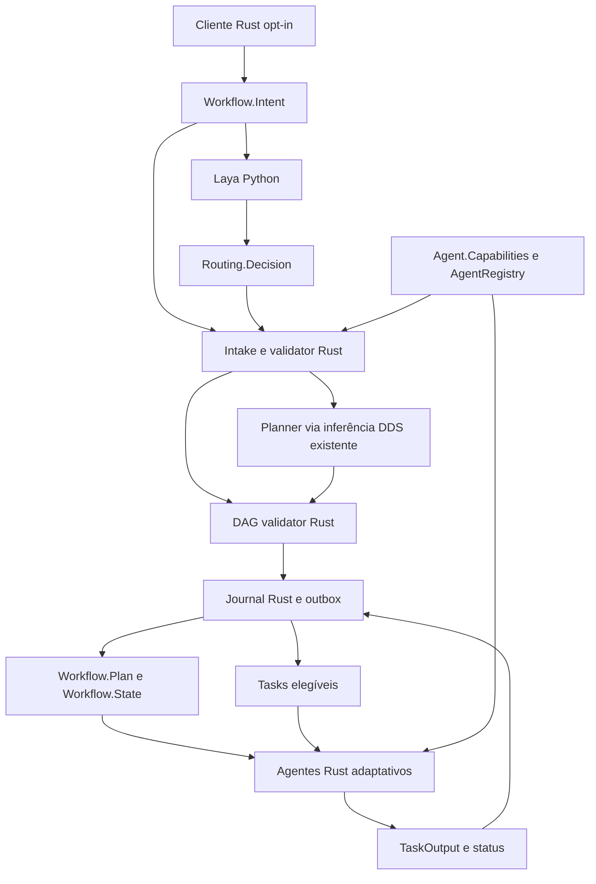

# Arquitetura proposta e fronteiras

Status: proposta de M0; decisões de compatibilidade aguardam revisão. Requisitos em [spec.md](spec.md), wire proposto em [contracts.md](contracts.md).

## Composição

- `workflow-engine` proposto: biblioteca de validação/estado e binário opt-in. Compor DataSpaceApi para Tasks/outputs/inferência com trait pequena `WorkflowSpace` para os cinco novos tópicos; implementações DDS e in-memory no módulo de transporte existente. Sem segundo DataSpaceApi nem dependência de `orchestrator`/`qos-nfcm`.
- Adapter do planner usa o caminho existente de `LLM.InferenceRequest/Result/Error`, reaproveitando correlação e provider constraints auditados. Não supor que MockProvider seja backend generativo. Saída do planner é JSON limitado por schema e convertido para structs tipadas antes de publicar Workflow.Plan; o wire estável não vira JSON opaco.
- Worker Python lê apenas SUBMIT, devolve previsão ou erro tipado; nenhum reader/writer de Tasks/TaskOutput no adapter. Verificação de permissões reais DDS é gate próprio, não inferida desses imports.
- Context-store continua dono dos contextos; Policy Engine/MCP permanecem donos da autorização e execução de ferramentas; observability recebe eventos com IDs/hashes/causas. Studio apenas observa futuramente, sem bloquear o core.

Interface proposta `WorkflowSpace: Send + Sync`: operações assíncronas `write_intent`, `write_decision`, `write_capabilities`, `write_plan`, `write_state`, cada qual recebendo o respectivo tipo gerado e retornando erro tipado; streams `subscribe_*` desses cinco tipos; consultas `read_plan(workflow_id, revision)`, `read_state(workflow_id, revision)` e `read_capabilities(agent_id)` para a barreira/replay. Streams expõem erro de lag/fechamento, não descartam silenciosamente amostras; snapshot seguido de eventos pode duplicar dados e exige dedup por chave/revisão. Implementar composição na camada existente, sem duplicar participante/pool global por requisição. Rust de domínio recebe traits, permitindo testes in-memory; mocks não prometem ownership DDS.

Os cinco endpoints novos só são criados por composição opt-in. `DataSpace::new` no caminho legado mantém os 19 tópicos e seus custos/configuração; catálogo novo fica separado (`workflow_topics::ALL`) do catálogo legado. Gerar tipos não autoriza instanciar readers/writers adaptativos em todos os benchmarks. O gate M1 mede essa ausência de alteração no modo desligado.

## Isolamento e readiness

Proposta V1: domínio DDS adaptativo distinto, configurado explicitamente, com agentes adaptativos e backend DDS apropriado; nenhuma ponte de Tasks para domínio legado. Modelo/backend é uma dependência de implantação a validar, não presumir que o servidor existente participe dos dois domínios.

Não iniciar o binário orchestrator legado no domínio adaptativo: seu loop NFCM altera writers globalmente. O novo processo não importa esse loop e publica Tasks com strength de cliente (10), não de supervisor (200). Agentes mantêm strength de agente (100) e readback. Recuperação adaptativa usa novas tentativas físicas, sem deixar writer forte bloquear claims. Testar esse protocolo, não apenas a configuração.

Antes de publicar Task, engine grava plano validado e tentativa no journal, publica Workflow.Plan/State e agenda a Task na outbox. Ordenação entre tópicos NÃO é pressuposta: agente só considera Task se consegue derivar seu ID a partir de um nó do plano e da tentativa ativa do estado, validar revisões, dependências, política e capabilities frescas. Dados ausentes implicam espera limitada; eventos de plano/estado reavaliam tasks pendentes. Revalidar antes do write de claim e depois do readback, antes de executar.

Um agente antigo com prefixo vazio não aplica essa barreira; por isso atualização parcial no mesmo domínio não está autorizada pela proposta. Domínio não impede participante malicioso: deployments não confiáveis exigem identidade/permissions DDS verificadas.

## Decisões e concorrência

Intake congela revisões esperadas no journal. Apenas decisões para essa tupla e dentro do prazo são candidatas. Um único engine aceita a primeira decisão válida mediante compare-and-set transacional no slot `(workflow_id, intent_revision)`; decisões posteriores não mudam o slot. O vencedor é estável após commit e replay, mas depende da ordem de chegada entre workers: não se promete escolha global independente dessa ordem nem consenso DDS.

Admissão da intenção é uma operação Rust anterior à liberação de trabalho Laya e usa a mesma autoridade de journal/orçamento. O ingresso autorizado compõe o serviço de intake; não é um novo protocolo HTTP entre Laya e Rust. Só então publica Workflow.Intent. Worker duplicado deve usar a mesma admissão/dedup ou ter custo máximo de redundância previamente reservado; sem essa reserva, não ativar workers redundantes cobrados. Invocações do planner/nós reservam tokens/custo na transação da outbox; saldo global e consumo incerto seguem contracts. Mensagens DDS recebidas de publicadores não autorizados não geram trabalho cobrado.

`decision_id` identifica produtor e processamento; mesmo ID com payload diferente é conflito auditado. Outbox só publica plano/tasks após decisão efetiva persistida. Em shadow, decisões são apenas observadas: nenhuma escrita de Task é permitida.

## Journal, tentativas e recuperação

Proposta [ADR-004](adrs/004-workflow-dag-and-recovery.md): SQLite local, único processo escritor com lock exclusivo; entidades workflow, decisão aceita, plano imutável, nós/tentativas, outbox e cursor de eventos. Reutilizar dependência rusqlite/padrão existente, não acoplar workflow ao banco administrativo do Studio. Context-store JSONL não oferece sozinho as transações necessárias. Sem SQLite WAL em CIFS.

- Identidade lógica: `(workflow_id, plan_revision, node_id)`; identidade física: SHA-256 de encoding canônico dessa tupla mais `attempt_id`, prefixado `laya1-`. Reenvio da mesma tentativa mantém ID; retry cria outro ID. O encoding usa campos UTF-8 precedidos de comprimento u32 big-endian e inteiros u32 big-endian; hashes representados em hex minúsculo.
- State guarda tentativa ativa e physical task_id. TaskOutput e status de IDs não ativos não liberam joins. Conteúdo só é final após status DONE, chunk final, validação de sequência/tamanho/autor e hash do output; chegada em qualquer ordem exige recomposição limitada.
- Transação grava tentativa + intenção de publicação; outbox repete publicação após restart. DDS TransientLocal não substitui journal. Ao reiniciar, republicar projeções e reconciliar tasks ativas antes de abrir nova tentativa.
- Engine controla retries adaptativos; reaper legado não atua nesse domínio. Cancelamento marca workflow e bloqueia novas publicações. Agente verifica state e cancela engine local; efeito já realizado pode persistir. Rejeitar resultados tardios sem alegar desfazimento.
- Ferramentas ficam desabilitadas na primeira ativação até prova de chave idempotente, autorização e tratamento de resultado incerto. Após crash entre efeito e registro, marcar `IN_DOUBT` e exigir reconciliação; não repetir automaticamente efeito não idempotente.
- Não suportar dois engines ativos ou failover automático entre hosts na V1. Lock local não é lease distribuída. Expansão requer ADR e prova adicionais.

## QoS, fallback e segurança

Inicialmente, QoS DDS estrutural de Tasks/outputs permanece fixo e compatível. Laya escolhe objetivo semântico; Rust valida e aplica prioridades/limites no domínio da aplicação. A escolha não altera ownership por workflow. Contratos e [ADR-002](adrs/002-application-qos-versus-native-dds-qos.md) declaram explicitamente o que cada objetivo entrega e o que não entrega.

Default de falha é rejeição tipada. Fallback direto só para template simples identificado e autorizado no ingresso; mantém capacidades/permissões/modelo mínimos fixados pelo template. Não derivar permissões de uma classificação rejeitada, nem transformar indisponibilidade de planner em execução irrestrita.

Registrar request/decision/workflow/revision/node/attempt, checkpoint/policy/questions hash, QoS solicitado/efetivo, fallback e duração por etapa. Logs não incluem prompt, output integral, segredos ou raciocínio interno do modelo. Capability anunciada é dado não confiável: catálogo/configuração e política autorizada limitam seu uso.
